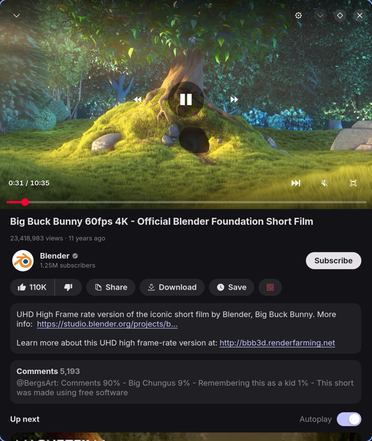
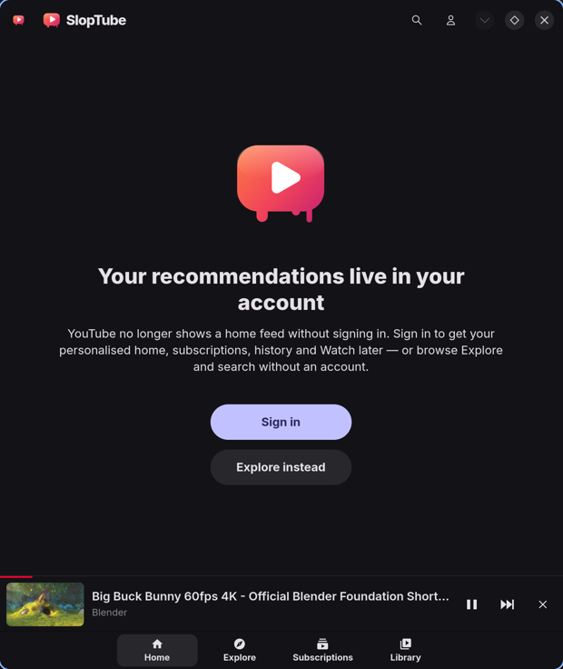
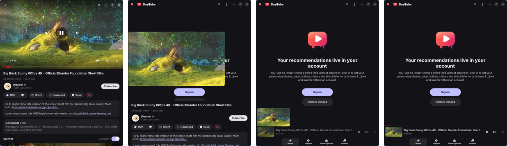
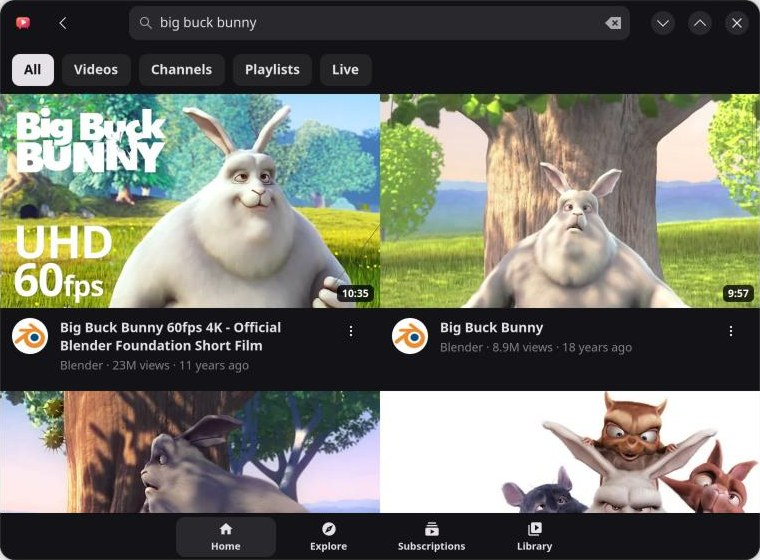
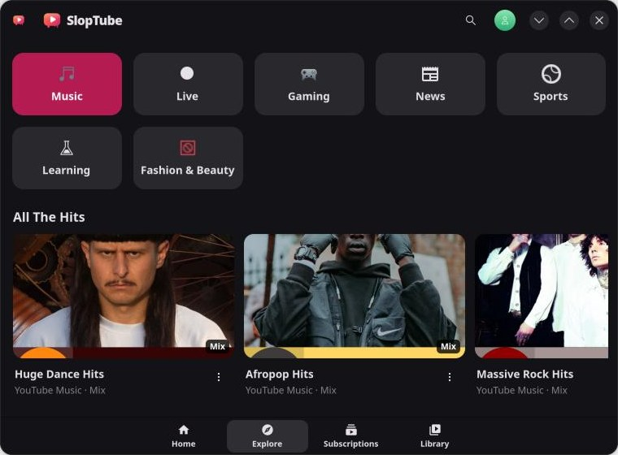

# SlopTube

A lightweight native YouTube client for Linux, written in Rust with GTK 4 and
libadwaita. The interface is modelled on the YouTube phone app and adapts from
phone to desktop. Video is decoded on the GPU or VPU through GStreamer (VA-API
or V4L2) and handed to the compositor without copies.

> [!WARNING]
> SlopTube is vibecoded: it was written largely by an AI coding assistant and
> has not been well tested. Expect bugs and rough edges, and see
> [Status](#status) for what has and hasn't been tried.

<p align="center">
  
  
</p>

## Why

The YouTube website is slow and memory-hungry, and browsers often decode its
video on the CPU. SlopTube keeps what matters and does it natively:

- the interface is GTK and libadwaita, not a web page;
- data comes from InnerTube, the JSON API the website itself uses;
- streams are resolved by [yt-dlp](https://github.com/yt-dlp/yt-dlp) and played
  by GStreamer, which picks a codec your hardware can decode.

On the development machine (Snapdragon X Elite, Arch Linux ARM) SlopTube uses
about 270 MB of resident memory when idle and 350 MB while playing 1080p60 AV1.
Most of that is shared libraries: the app's own anonymous memory is about 70 MB
and 95 MB. Playback runs on the hardware decoder with no dropped frames.

## Features

- **Tabs like the phone app**: Home, Explore, Subscriptions and Library, with
  a bottom tab bar on narrow windows and a sidebar on wide ones.
- **Explore**: Music, Live, Gaming, News, Sports, Learning, Fashion & Beauty.
- **Search** with suggestions, history and filters (videos, channels,
  playlists, live).
- **Watch page**: like and dislike, subscribe, share, download, save to Watch
  later, a description with clickable timestamps and links, comments with
  replies (top or newest), and Up next with autoplay.
- **Player**: quality and speed (0.25×–2×) menus, audio-only mode, fullscreen,
  keyboard shortcuts, double-tap to seek on touchscreens, resume where you left
  off, Play all and Shuffle for playlists.
- **Mini player**: drag the video down and it follows your finger into a bar
  above the tabs, as on Android. Drag or tap the bar to bring it back, swipe it
  sideways to close it.
- **Background playback** after the window is closed, and **MPRIS** for media
  keys and desktop media controls.
- **Channels and playlists**, and, when signed in, your history, Watch later,
  liked videos, playlists and channels.
- **Downloads** through yt-dlp, listed under Library → Downloads.
- **Google account**: sign in inside the app, or import the session from a
  Chromium-based browser. The session is kept in your keyring.
- **No Shorts and no ads** in feeds.
- **Hardware decoding** of AV1, VP9 and H.264 through VA-API or V4L2, chosen
  automatically, with *Stats for nerds* to confirm it.

<p align="center">
  
</p>
<p align="center">
  
  
</p>

## Status

SlopTube is young and has only run on one machine so far: a Dell XPS 13 9345
(Snapdragon X Elite) with Arch Linux ARM and Hyprland.

- **Tested there**: browsing and searching without an account, Explore, playback
  with hardware AV1 decoding (1080p60, zero-copy, no dropped frames), seeking and
  resuming, the mini player and its gestures, MPRIS controls, and the API parsers
  against live YouTube responses.
- **Not tested yet**: everything that needs an account (signing in, the Home and
  Subscriptions feeds, the library, likes, subscribing, Watch later, watch
  history), downloads, VA-API decoding (that machine has no VA-API driver),
  background playback after closing the window, live streams, and the channel,
  playlist, comment and preferences screens beyond their parsers.

If playback misbehaves, the output of `sloptube --diagnose` (see
[Command line](#command-line)) is the most useful thing to include in a report.

## Requirements

GTK 4.20 or newer, libadwaita 1.7 or newer, GStreamer 1.24 or newer (tested
with 1.28), and yt-dlp with a JavaScript runtime. On Arch Linux:

```sh
sudo pacman -S --needed gtk4 libadwaita gstreamer gst-plugins-base gst-plugins-good \
    gst-plugins-bad gst-plugins-bad-libs yt-dlp yt-dlp-ejs deno webkitgtk-6.0 \
    sqlite openssl
```

| Package | What for |
|---|---|
| `gtk4`, `libadwaita` | The interface. |
| `gstreamer`, `gst-plugins-base`, `gst-plugins-good` | Playback: playbin3, the HTTP source, MP4 and WebM demuxers, DASH, Opus and VP9 decoding, V4L2 stateful decoders, audio output. |
| `gst-plugins-bad`, `gst-plugins-bad-libs` | AAC, AV1 (aom) and H.264 (OpenH264) software decoders, video parsers, V4L2 stateless decoders. |
| `yt-dlp`, `yt-dlp-ejs`, `deno` | Stream extraction. YouTube makes yt-dlp run JavaScript, so it needs a runtime such as Deno. |
| `sqlite`, `openssl` | Reading cookies from browser profiles and decrypting them, and the keyring client. |
| `webkitgtk-6.0` | The in-app Google sign-in. Only needed with the `webkit` build feature (on by default). |
| `gst-plugin-va` *(recommended)* | VA-API hardware decoding on Intel, AMD and other VA-API GPUs. |
| `gnome-keyring` *(recommended)* | Or any other Secret Service provider, to store the session. Without one it goes to a private file. |
| `gst-libav`, `gst-plugin-dav1d` *(optional)* | Faster software decoders for machines without hardware decoding. |

To build you also need Rust 1.96 or newer and `pkgconf`.

## Building and installing

```sh
cargo build --release
./target/release/sloptube
```

Build features:

| Feature | Default | Effect |
|---|---|---|
| `webkit` | on | In-app Google sign-in through WebKitGTK 6.0. Without it, signing in works only by importing a browser session. Linux only: other platforms build without it. |
| `static-sink` | on | Compiles GStreamer's `gtk4paintablesink` into the binary. Without it the system `gst-plugin-gtk4` package is used. |

For example, `cargo build --release --no-default-features --features static-sink`
builds without WebKitGTK.

On Arch Linux, [`pkg/arch/PKGBUILD`](pkg/arch/PKGBUILD) builds a
`sloptube-git` package that installs system-wide and pulls in the runtime
dependencies. To package your local checkout:

```sh
cd pkg/arch
SLOPTUBE_SRC=file://$(git rev-parse --show-toplevel) makepkg -si
```

Without `SLOPTUBE_SRC` it builds from the GitHub repository.

To install for your user only, without a package:

```sh
install -Dm755 target/release/sloptube ~/.local/bin/sloptube
install -Dm644 data/io.github.nergzd.SlopTube.desktop -t ~/.local/share/applications/
install -Dm644 data/icons/scalable/apps/io.github.nergzd.SlopTube.svg -t ~/.local/share/icons/hicolor/scalable/apps/
install -Dm644 data/icons/scalable/apps/io.github.nergzd.SlopTube-symbolic.svg -t ~/.local/share/icons/hicolor/symbolic/apps/
```

Everything else (stylesheet, icons, the yt-dlp helper script) is compiled into
the binary.

## Using SlopTube

### Opening links

Pass YouTube links or video IDs on the command line. If SlopTube is already
running, they open in the existing window.

```sh
sloptube https://www.youtube.com/watch?v=aqz-KE-bpKQ
sloptube aqz-KE-bpKQ
```

It understands `watch` links (including `t=` and `list=`), `youtu.be`, `/shorts/`
and `/live/` (opened as normal videos), `/playlist?list=`, `/channel/…`,
`/@handle` and `/results?search_query=`, on `www.`, `m.` and `music.youtube.com`.
<kbd>Ctrl</kbd>+<kbd>L</kbd> opens a link box, filled in from the clipboard when it
holds a YouTube link.

### Keyboard shortcuts

| Keys | Action |
|---|---|
| <kbd>Ctrl</kbd>+<kbd>F</kbd>, <kbd>Ctrl</kbd>+<kbd>K</kbd> | Search |
| <kbd>Ctrl</kbd>+<kbd>L</kbd> | Open a YouTube link |
| <kbd>Ctrl</kbd>+<kbd>R</kbd>, <kbd>F5</kbd> | Refresh the feed |
| <kbd>Ctrl</kbd>+<kbd>,</kbd> | Preferences |
| <kbd>Ctrl</kbd>+<kbd>?</kbd> | Keyboard shortcuts |
| <kbd>F11</kbd> | Fullscreen |
| <kbd>Ctrl</kbd>+<kbd>W</kbd> | Close the window (keeps playing in the background if enabled) |
| <kbd>Ctrl</kbd>+<kbd>Q</kbd> | Quit |

While the player is open:

| Keys | Action |
|---|---|
| <kbd>Space</kbd>, <kbd>K</kbd> | Play or pause |
| <kbd>J</kbd> / <kbd>L</kbd> | Back / forward 10 seconds |
| <kbd>←</kbd> / <kbd>→</kbd> | Back / forward 5 seconds |
| <kbd>↑</kbd> / <kbd>↓</kbd> | Volume |
| <kbd>M</kbd> | Mute |
| <kbd>F</kbd> | Fullscreen |
| <kbd>0</kbd> … <kbd>9</kbd> | Jump to 0 %–90 % |
| <kbd>Home</kbd> | Jump to the start |
| <kbd>Shift</kbd>+<kbd>N</kbd> / <kbd>Shift</kbd>+<kbd>P</kbd> | Next / previous video |
| <kbd>I</kbd> | Stats for nerds |
| <kbd>Esc</kbd> | Leave fullscreen, or minimise the player |

Media keys work too, through MPRIS.

### Mouse and touch

- **Drag the video down** to minimise it into the mini player. It follows the
  pointer or finger; a quick flick is enough. **Drag it up** to go fullscreen.
- **Tap the mini player, or drag it up**, to open the player again. **Swipe it
  sideways** to stop playback and close it.
- On a touchscreen, tap the video to show or hide the controls and double-tap
  its left or right third to seek 10 seconds. With a mouse, click to play or
  pause and double-click for fullscreen.

### Preferences

- **Playback**: preferred codec (automatic picks what your hardware decodes),
  maximum quality (1080p by default), 60 fps, hardware decoding, autoplay,
  resume playback, and keeping playback going after the window is closed.
- **Account**: sign in or out, use the account for video streams (needed for
  age-restricted and members-only videos and Premium quality), and add watched
  videos to your YouTube history.
- **General**: light or dark style, content region, search history, download
  folder and download quality.

## Accounts and privacy

YouTube no longer shows a home feed to signed-out users, so without an account
the Home tab points you to Explore and Search. Everything else works signed out.

There are two ways to sign in, under the account button or in Preferences:

- **Sign in with Google** opens Google's sign-in page in an embedded WebKitGTK
  view with a throwaway in-memory session. When the page lands back on YouTube,
  SlopTube copies YouTube's cookies and closes the view. It does not read what
  you type.
- **Import from a browser** copies the YouTube cookies of a Chromium, Google
  Chrome, Brave, Vivaldi or Microsoft Edge profile, decrypting them with that
  browser's key from the keyring. The copy may stop working when the browser
  rotates its cookies; signing in gives SlopTube a session of its own. Firefox is
  not supported yet.

The session is stored in the Secret Service keyring (gnome-keyring, KWallet,
…) as "SlopTube YouTube session". Without a keyring it goes to
`~/.local/share/sloptube/session.json`, readable only by you. Signing out
removes it.

Cookies are only attached to requests for the domains they belong to. To let
yt-dlp use the account, SlopTube writes them to
`$XDG_RUNTIME_DIR/sloptube/cookies.txt` (a private tmpfs file, deleted when you
sign out); turn off *Use account for video streams* to keep yt-dlp signed out.

With *Add watched videos to YouTube history* on (the default), SlopTube reports
playback progress the way the website does, so videos appear in your history and
resume positions sync with other devices. Search suggestions come from Google's
suggestion service as you type, as on the website.

## Hardware decoding

At startup SlopTube asks GStreamer for every video decoder and treats those
marked as hardware decoders as such: VA-API (`va*`), V4L2 stateful (`v4l2*dec`)
and V4L2 stateless (`v4l2sl*dec`) decoders, among others. With hardware decoding
on, it ranks them above software decoders and picks the video stream by, in
order of importance:

1. a codec the hardware can decode;
2. the highest resolution up to your maximum;
3. a frame rate your 60 fps setting allows;
4. the codec chosen in Preferences, then AV1, VP9 and H.264 for hardware, or the
   cheapest to decode in software (H.264, then VP9, then AV1);
5. the higher frame rate and bitrate.

So a codec chosen in Preferences wins over another codec only when both, or
neither, can be decoded in hardware.

Decoded frames stay in GPU memory as DMABufs and reach GTK through
`gtk4paintablesink` inside a `GtkGraphicsOffload`, so the compositor can show
them directly when it supports that.

To check what is happening, open the player's settings menu and enable *Stats
for nerds* (or press <kbd>I</kbd>): it shows the decoder, whether frames are
DMABufs, the format and dropped frames. `sloptube --diagnose` prints the same
from the command line.

Some V4L2 stateful decoders, such as Qualcomm's Iris, stop producing frames
after a flushing seek. SlopTube therefore resets V4L2 stateful decoders around
each seek. If yours handles seeks fine, `SLOPTUBE_NO_DECODER_RESET=1` turns this
off.

## Command line

| Option | Effect |
|---|---|
| `URL` or `VIDEO_ID` … | Open these (see [Opening links](#opening-links)). |
| `--diagnose[=VIDEO_ID]` | Start a separate, muted instance that plays a video (Big Buck Bunny by default), prints the decoder, DMABuf use, frame rate, dropped frames and memory once a second, seeks to 1:00 after 7 seconds, saves snapshots of a frame to `$XDG_RUNTIME_DIR/sloptube/diagnose-*.png`, and quits. Settings are not saved. |
| `--selftest` | Without opening a window: list the decoders found, then check search, the watch page, comments, a channel, a playlist, Explore, suggestions and stream extraction against YouTube. |

| Environment variable | Effect |
|---|---|
| `RUST_LOG` | Log filter, `sloptube=info` by default. `sloptube=debug` also logs every API request with its timing. |
| `GST_DEBUG` | GStreamer's own logging, e.g. `GST_DEBUG=2`. |
| `SLOPTUBE_YTDLP` | Path of the `yt-dlp` to use instead of the one on `PATH`. |
| `SLOPTUBE_YTDLP_PYTHON` | Python interpreter for the yt-dlp helper (normally taken from the `yt-dlp` script's shebang). |
| `SLOPTUBE_WINDOW_SIZE` | Initial window size, e.g. `390x844` to try the phone layout. |
| `SLOPTUBE_NO_DECODER_RESET` | Don't reset V4L2 decoders around seeks. |
| `SLOPTUBE_DIAGNOSE_SECS` | How long `--diagnose` runs (14 seconds by default, at least 10). |
| `SLOPTUBE_DIAGNOSE_IDLE` | Make `--diagnose` measure without playing anything. |
| `SLOPTUBE_DIAGNOSE_SHEET` | Make `--diagnose` drive the mini-player animation instead of seeking. |
| `SLOPTUBE_FIXTURES` | Directory of saved API responses for the parser tests (see [Development](#development)). |

## Files

| Path | Contents |
|---|---|
| `~/.config/sloptube/settings.json` | Preferences and search history. |
| `~/.local/share/sloptube/positions.json` | Resume positions. |
| `~/.local/share/sloptube/downloads.json`, `thumbnails/` | The download list and its thumbnails. |
| `~/.local/share/sloptube/session.json` | The session, only when no keyring is available. |
| `~/Videos/SlopTube/` | Downloads (changeable in Preferences). |
| `$XDG_RUNTIME_DIR/sloptube/` | The yt-dlp cookie file, generated DASH manifests and `--diagnose` snapshots. |

## Troubleshooting

**The app looks unstyled or has the wrong colours.** libadwaita ignores its own
stylesheet when `GTK_THEME` is set. SlopTube removes `GTK_THEME=Adwaita` (and
variants such as `Adwaita:dark`) from its own environment, keeping the dark
preference, but any other theme still breaks it. Unset `GTK_THEME` for
SlopTube.

**Videos don't start, or fail with "403", "Sign in to confirm you're not a bot"
or similar.** YouTube changes often; update yt-dlp first, and make sure Deno and
`yt-dlp-ejs` are installed. `yt-dlp -F <link>` shows whether yt-dlp itself can
get the formats.

**Video plays in software although the hardware should do it.** Check *Stats
for nerds* or `sloptube --diagnose`, and `gst-inspect-1.0 | grep -i dec` for the
decoders GStreamer knows. VA-API needs `gst-plugin-va` and a VA driver (Mesa for
AMD, `intel-media-driver` for Intel); V4L2 needs access to `/dev/video*` and
`/dev/media*`. Also make sure *Hardware decoding* is on in Preferences.

**Something else.** Run `RUST_LOG=sloptube=debug sloptube` from a terminal and
look at the log.

## Known limitations

- No subtitles and no chapter markers yet, although both are extracted.
- No live chat, and live streams are untested.
- Comments are read-only.
- Shorts are hidden on purpose.
- Browser import only supports Chromium-based browsers.

## Development

[docs/ARCHITECTURE.md](docs/ARCHITECTURE.md) explains how the code is organised,
how playback works, and why it works that way.

The parser tests run against real YouTube responses. They are skipped unless
`SLOPTUBE_FIXTURES` names a directory of them, which
[tools/fetch-fixtures.py](tools/fetch-fixtures.py) creates:

```sh
tools/fetch-fixtures.py target/fixtures
SLOPTUBE_FIXTURES=target/fixtures cargo test
```

Re-fetch the fixtures when YouTube changes its responses and a parser needs
fixing.

## Credits and license

SlopTube is built on GTK, libadwaita, GStreamer (including `gst-plugin-gtk4`)
and yt-dlp. The tab and action icons come from Google's Material Symbols
(Apache-2.0).

SlopTube is licensed under the GNU General Public License, version 3 or later.
It is not affiliated with YouTube or Google.
